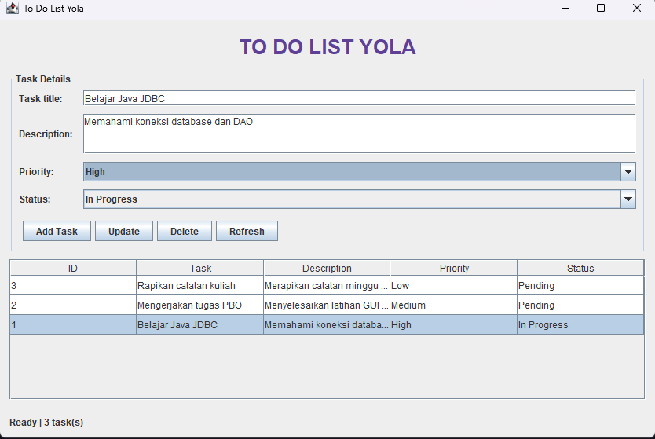
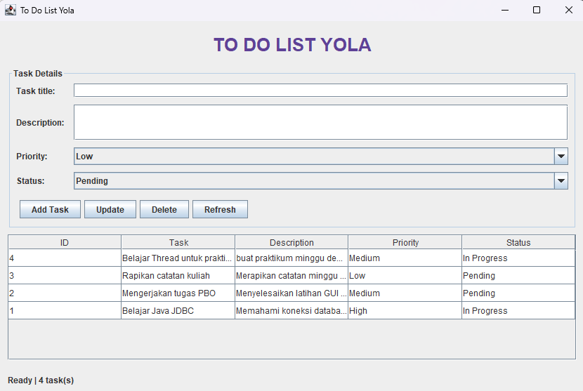
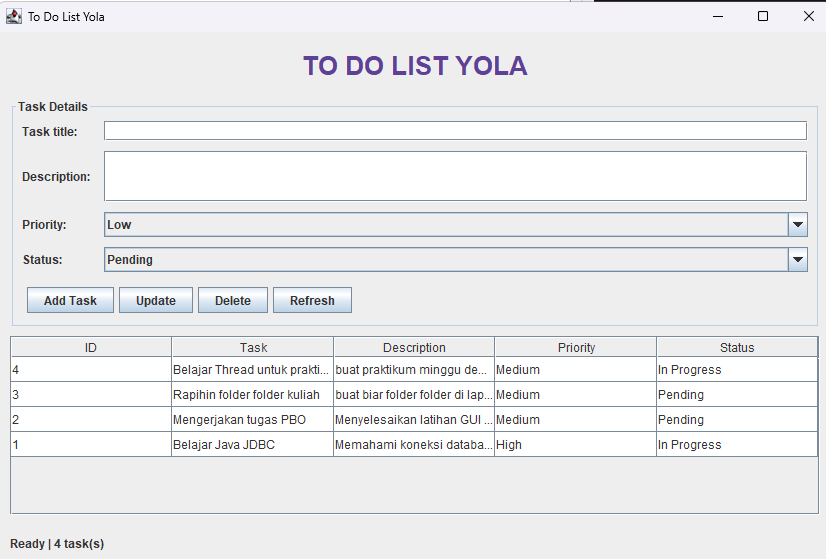
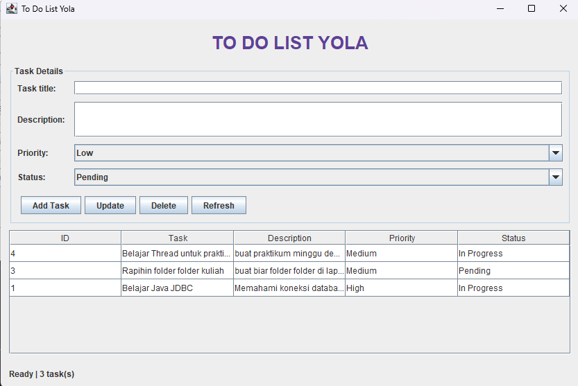
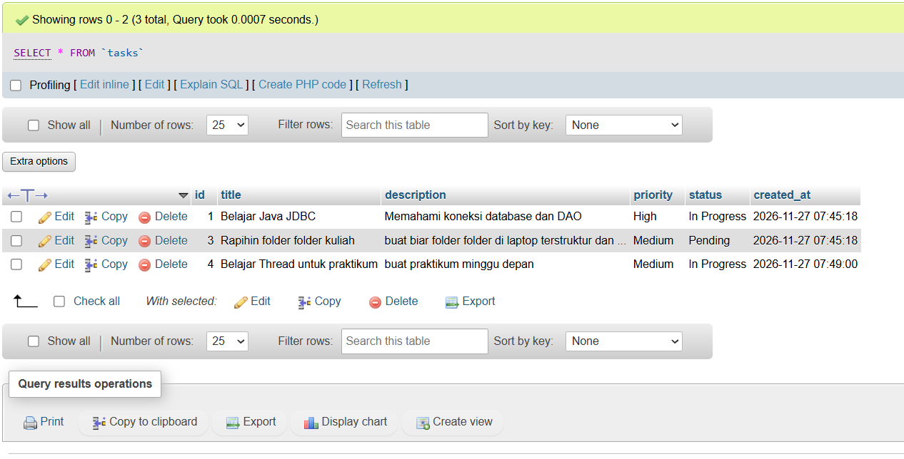

# To Do List Yola

Aplikasi To Do List sederhana berbasis Java Swing untuk mencatat dan mengatur tugas sehari-hari. Project ini dibuat sebagai latihan materi Java Database, CRUD, DAO, dan Thread.

## NAMA : BAIQ ERWINA YOLANDA

## NIM : F1D02410039

## Tampilan aplikasi

Screenshot hasil aplikasi bisa dilihat di folder `screenshot/`.

### Halaman utama



### Tambah todo



### Update todo



### Delete todo



### Database MySQL



## Fitur

- Melihat daftar task dari database
- Menambahkan task baru
- Mengedit task yang sudah ada
- Menghapus task
- Menentukan prioritas task: Low, Medium, atau High
- Mengatur status task: Pending, In Progress, atau Completed
- Menampilkan status proses seperti `Saving...`, `Updating...`, dan `Deleting...`

## Teknologi yang digunakan

- Java
- Java Swing untuk tampilan
- MySQL sebagai database
- JDBC dan MySQL Connector/J
- `PreparedStatement` dan `ResultSet`
- `ExecutorService` untuk menjalankan proses database di background
- `SwingUtilities.invokeLater()` untuk memperbarui tampilan GUI

## Struktur folder

```text
TO_DO_LIST_YOLA/
├── database/
│   └── todo_yola.sql
├── lib/
│   └── mysql-connector-j-*.jar
├── screenshot/
│   ├── 1.halamanutama.png
│   ├── 2.tambahtodo.png
│   ├── 3.updatetodo.png
│   ├── 4.deletetodo.png
│   └── 5.ssdmysql.png
├── src/
│   ├── Database.java
│   ├── Main.java
│   ├── Task.java
│   └── TaskDAO.java
├── .gitignore
├── README.md
└── run.bat
```

## Cara menjalankan

### 1. Siapkan aplikasi

Pastikan sudah terpasang:

- JDK (disarankan JDK 17)
- MySQL Server
- MySQL Workbench
- Visual Studio Code dan Extension Pack for Java

### 2. Buat database

1. Buka MySQL Workbench dan sambungkan ke server MySQL.
2. Buka file `database/todo_yola.sql`.
3. Jalankan script SQL.
4. Pastikan database `todo_yola` dan tabel `tasks` sudah dibuat.

### 3. Tambahkan MySQL Connector

Download MySQL Connector/J dari halaman resmi:
https://dev.mysql.com/downloads/connector/j/

Pilih **Platform Independent**, ekstrak file ZIP, lalu copy file `.jar` ke folder `lib`.

Di VS Code:

1. Buka panel **JAVA PROJECTS**.
2. Cari **Referenced Libraries**.
3. Klik tombol `+`.
4. Pilih file MySQL Connector `.jar` yang ada di folder `lib`.

### 4. Sesuaikan koneksi database

Buka `src/Database.java`. Kalau username atau password MySQL kamu berbeda, sesuaikan bagian koneksinya.

### 5. Jalankan program

Buka `src/Main.java`, lalu klik **Run** pada method `main()`.

Bisa juga menjalankan `run.bat` dari folder project, selama JDK dan Connector sudah tersedia.

## Cara menggunakan

- Isi judul task dan deskripsi.
- Pilih priority dan status.
- Klik **Add Task** untuk menambahkan tugas.
- Klik salah satu baris tabel untuk memilih task.
- Ubah data di form, lalu klik **Update** untuk menyimpan perubahan.
- Pilih task dan klik **Delete** untuk menghapusnya.
- Klik **Refresh** jika ingin memuat ulang daftar task.

## Sedikit tentang kode program

### `Task.java`

Class ini menjadi model untuk data task, seperti ID, judul, deskripsi, prioritas, dan status.

### `Database.java`

Bagian ini mengatur koneksi Java ke MySQL.

### `TaskDAO.java`

Query database diletakkan di sini agar tidak bercampur dengan kode tampilan. File ini menangani:

- `SELECT` untuk membaca task
- `INSERT` untuk menambah task
- `UPDATE` untuk mengubah task
- `DELETE` untuk menghapus task

Query menggunakan `PreparedStatement`, sedangkan data hasil query dibaca dengan `ResultSet`. Operasi perubahan data juga menggunakan transaction dengan `commit()` dan `rollback()`.

### `Main.java`

Bagian tampilan aplikasi sekaligus penghubung antara form, tabel, dan DAO.

Proses database dijalankan di background menggunakan `ExecutorService`, jadi GUI tidak perlu menunggu proses query selesai. Setelah proses database selesai, tampilan diperbarui menggunakan `SwingUtilities.invokeLater()`.

Contoh alur saat menambahkan task:

```text
Klik Add Task
      ↓
Tombol dinonaktifkan dan status "Saving..."
      ↓
Database diproses di background thread
      ↓
Proses selesai
      ↓
invokeLater() memperbarui GUI
      ↓
Tabel diperbarui dan tombol aktif kembali
```

## Tujuan project

Project ini dibuat untuk latihan memahami bagaimana aplikasi Java desktop terhubung ke database, melakukan CRUD, dan menjalankan proses database di thread terpisah supaya tampilan tetap responsif.
